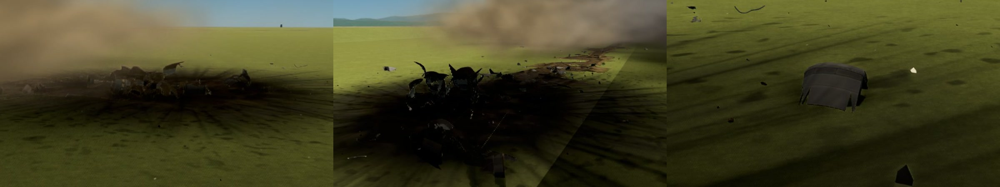

# Fragmentation

Crashes as they are. A craft that hits the ground breaks up from the parts that hit it, and what breaks is
the parts' own skins: a tank is crushed in at the end that hit, has its underside torn away as it slides,
splits, leaks for a moment and goes up. A rocket that comes in at a slant digs into soft ground, tears itself
open, scoops up the earth and stops within tens of metres, leaving a scar of torn earth and a trail of torn
panels, rings and shreds of itself, every piece trailing a little smoke. Parts from other mods break up as the
game's own do.

*The same throw, filmed twice from the same place, each time in a scene loaded afresh, at the same moments: 0.9,
1.4, 2.0, 2.9 and 5.6 seconds after the throw; the test rocket's tanks a tenth full, so that its fire does not hide
the rest. Above, with Fragmentation: it touches, slides away from the camera raising the ground's dust and tearing
its underside open, its tanks split and go up one after another, and the wreck stops some 80 m from where it
touched, burning at the end of the scar it dug. Below, the game's own crash, with Volumetric Explosions' fire: every part goes up
where it first touched, close in front of the camera, and the cloud of it fills the view.*

*What is left, close by: the wreck where it stopped, on its burn mark (left); the same from the other side, the
scar it dug coming in behind it (middle); a torn piece of a tank's skin, its edge in strips, and an arc of one of
its rings beyond (right).*

For Kerbal Space Program 1.12.x. Needs [Keystone](https://github.com/IshiakiZ/ksp-keystone). Works with
[Volumetric Explosions](https://github.com/IshiakiZ/ksp-volumetric-explosions) where it is installed (its fire and smoke are then the
explosions, and leaks, fires, the smoke of every piece and the dust of a slide go into its air); both come in the
download.

**Nothing in it is particular to one system**: it is plain C#, with no shader of its own. The fire and smoke
are Volumetric Explosions', which draws them as a volume on OpenGL (a Mac, Linux) and, with its shaders built
for Direct3D, on Windows. Where that mod draws flat sprites instead (an older copy of it), the leaks, burning
pieces and dust of this one are not drawn at all.

## What it does

* **Parts tear.** Each part's skin is cut into panels, few large and many small, from its own meshes (any part
  from any mod). A blow crushes the end that hit and folds the rest; dragged along the ground, the underside is
  torn away panel by panel and the top kept; a tank torn right round comes apart; a part that has lost the skin
  where it is joined to the next comes away from it.
* **A wreck digs in.** On soil it ploughs, deeper as it goes; torn open, it scoops up the earth and holds in it.
  On paving it scrapes, and steel throws sparks.
* **Tanks split before they go up**: what is in a split tank comes out for a moment (alight, most times, where
  there is oxygen), then the rest goes up there, while the wreck goes on burning.
* **The pieces are the parts' own**: torn panels with their insides and torn edges showing, rings and stringers
  out of torn tanks, engines whole; shreds, rivets, foil, clods and slabs of turf. Solid, thrown by blasts, at rest
  they cost nothing.
* **In orbit too**: a craft that clips another tears at what it hits; a holed tank leaks and goes up.

## Install

Copy the `Keystone`, `VolumetricExplosions` and `Fragmentation` folders from the download's `GameData` into
your KSP `GameData`.

## Settings

In the Keystone window (the keystone button on the game's toolbar, or Option-K on a Mac, Alt-K elsewhere).

| Setting | Installed as | |
| --- | --- | --- |
| Fragmentation | on | off: crashes as the game has them |
| How far a wreck slides | 1 | more: further |
| How tough parts are | 1 | more: craft hold together longer |
| Pieces at most | 150 | |
| How long pieces stay | 120 s | |
| Leaks, fires and dust | on | needs Volumetric Explosions |

## Good to know

* While a craft could hit something at speed, its parts' crash tolerance is raised (a mod that shows it will
  show a very large number) and this mod decides what a blow does. A craft that touches down within its parts'
  tolerances is not hurt, as in the game. What water does is left to the game.
* A big crash costs about what the game's own crash with Volumetric Explosions costs (the same throw, measured
  each way in a scene loaded afresh: 31 to 38 frames a second through the ten seconds after it, against 28 to 35;
  the worst single frame 170 ms against 147; Apple M5 Pro, 1280 by 720).
* Made on 2026-10-09 and 10; see [what was tested](docs/What-was-tested.md). Nobody has
  played with it yet.

## Where it works

| System | |
| --- | --- |
| Mac | Made and tried here (KSP 1.12.5, OpenGL). |
| Windows | Tried on Windows 11 (KSP 1.12.5, Direct3D 11; 0.1, before 0.2.0's tearing and trails), with Volumetric Explosions: Kerbal X crashed by the pad, its parts dented and broken by this mod (its lines in the game's log), the wreck sliding 26 m, the fire and smoke drawn as a volume. Then 0.2.0: Kerbal X thrown into the assembly building's wall at 60 m/s, 25 m up: the pod went up, tanks split and leaking ("8000 kg in it, alight"), 78 pieces of wreckage, smoke up the building's face; 53 to 65 frames a second just after. |
| Linux | **Never run.** |

More: [how it works](docs/How-it-works.md), [what it is based on](docs/Research.md),
[limits](docs/Limits.md).
