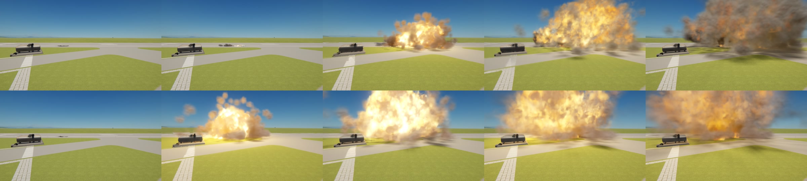

# Fragmentation

Crashes as they are. A craft that hits the ground breaks up from the parts that hit it: tanks are crushed, torn open
as they slide, split, leak and go up, and the wreck digs a scar into the ground and leaves a trail of its own torn
pieces. Parts from other mods break up as the game's own do.

*The same throw with Fragmentation (above) and without it (below).*

For Kerbal Space Program 1.12.x. **Needs [Keystone](https://github.com/IshiakiZ/ksp-keystone)**, a separate download
([on SpaceDock](https://spacedock.info/mod/4665/Keystone)): this mod does not load without it.
[Volumetric Explosions](https://github.com/IshiakiZ/ksp-volumetric-explosions) ([on SpaceDock](https://spacedock.info/mod/4669/Volumetric%20Explosions))
is not needed, but the leaks, the fires and the smoke of every piece are drawn only with it.

## What it does

* **Parts tear:** a blow crushes the end that hit, and a part dragged along the ground has its underside torn away
  panel by panel.
* **A wreck digs in** on soil and scrapes on paving. It does not bound along the ground or roll on like a wheel.
* **Tanks split before they go up,** leaking and alight.
* **The pieces are the parts' own:** torn panels, rings out of torn tanks, engines' bells.
* **In orbit too:** a craft that clips another tears at what it hits.

## Install

Copy the `Fragmentation` folder from the download into your KSP's `GameData`, beside `Keystone`.

## Settings

In the Keystone window (the keystone button on the game's toolbar, or Alt-K; Option-K on a Mac): how far a wreck
slides, how tough parts are, how many pieces there may be and how long they stay.

## Good to know

* A craft that touches down within its parts' crash tolerances is not hurt, as in the game. What water does is left
  to the game.
* While a craft could hit something at speed, a mod that shows a part's crash tolerance will show a very large
  number: this mod is deciding what a blow does.
* A big crash costs about what the game's own crash with Volumetric Explosions costs.

## Works on

Windows 11 (Direct3D 11) and Mac: tried. Linux: never run.

**More:** [the long description](docs/The-long-description.md) (everything in full, and what
was tried on each system) and the rest of the [wiki](docs/README.md).

## Licence

[CC BY 4.0](LICENSE): use it, change it and pass it on as you like, as long as you credit Ishiaki and link back here.
