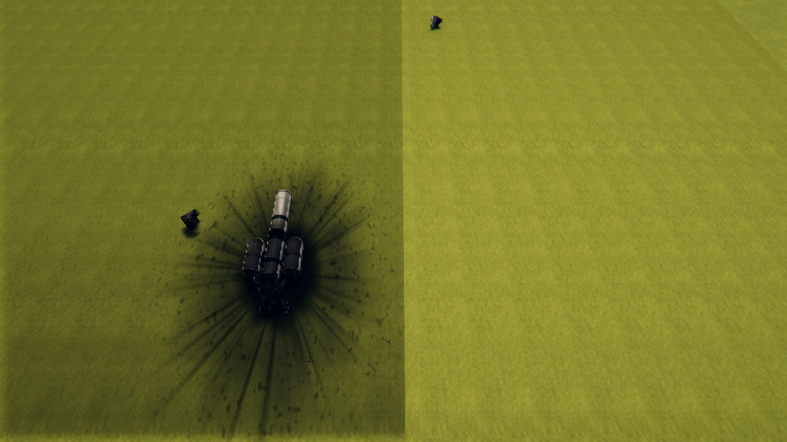

# Fragmentation

Crashes as they are. A craft that hits the ground breaks up from the parts that hit it; one that comes in at
a slant slides and tumbles on along the ground and comes apart as it goes; split tanks leak for a moment and
then go up; and every part that is destroyed falls apart into pieces of its own skin, which are solid, hit
things and come to rest. Parts from other mods break up as the game's own do.

*The same throw, filmed twice, each in a scene loaded afresh at the same hour, the frames 1.0, 1.9, 2.6 and
4.6 seconds after the throw; the test rocket's tanks a tenth full, so that its fire does not hide the rest.
Above, with Fragmentation: it touches, slides on raising the ground's dust and comes apart as it goes (20 parts
to 13), and a split tank goes up further along; the main wreck stopped 70 m (230 feet) from where it touched.
Below, the game's own crash, with Volumetric Explosions' fire: every part that touched went up where it
touched.*

*What was left: the main wreck, real parts still, where it stopped on its burn mark; the pod and pieces about it.*

For Kerbal Space Program 1.12.x. Needs [Keystone](https://github.com/IshiakiZ/ksp-keystone). Works with
[Volumetric Explosions](https://github.com/IshiakiZ/ksp-volumetric-explosions) 0.4.0 or later where it is installed (then the
explosions are its fire and smoke, and leaks, burning pieces and the dust of a slide go into its air); both
come in the download.

**Nothing in it is particular to a Mac**: it is plain C#, with no shader of its own. But it has only ever
been run on a Mac: it has **not been run on Windows or Linux**. The fire and smoke are Volumetric Explosions',
which draws them as a volume only on OpenGL (a Mac, Linux); on Windows that mod draws flat sprites, and the
leaks, burning pieces and dust of this one are not drawn at all.

## What it does

* **The breakup comes from the craft.** Each part reports what it touches. A part that hits the ground is
  crushed by as much of the craft's energy as goes into the ground there; one that holds stops the craft
  going into the ground but not along it; the craft is turned over by the blow, and the next part comes down.
* **A wreck slides.** On the ground it is slowed by friction and, on soil, by ploughing into it, and turned
  and tumbled by where it touches; the parts that drag are ground away, shedding pieces, and torn off.
* **Tanks split before they go up.** What is in a split tank comes out for a moment (alight, most times, where
  there is air with oxygen; where there is none, if it carries its own oxidiser) and pushes the craft the other
  way; then the rest goes up, at that place, while the wreck goes on. So a slide leaves fires and explosions
  along its way, not one blast where it began. One that does not catch runs out, and nothing goes up.
* **In orbit too.** A craft that clips another tears at what it hits: a tank holed by a part driven into it
  leaks, burning, for a second or so and goes up.
* **Pieces of the part itself.** A destroyed part's own meshes are cut into pieces, few large and many small,
  scorched where they burned; each is solid, with its share of the part's mass, and is thrown by blasts.
  They come to rest and cost nothing lying still; the oldest go when there are too many.
* **The game's own explosions.** A part that carried propellant goes up through the game's own explosion
  (Volumetric Explosions' fire, where installed), told it was a crash, and how fast.

## Install

Copy the `Keystone`, `VolumetricExplosions` and `Fragmentation` folders from the download's `GameData` into
your KSP `GameData`.

## Settings

In the Keystone window (the keystone button on the game's toolbar, or Option-K on a Mac, Alt-K elsewhere).

| Setting | Installed as | |
| --- | --- | --- |
| Fragmentation | on | off: crashes as the game has them |
| How far a wreck slides | 1 | more: further |
| How tough parts are | 1 | more: craft hold together longer |
| Pieces at most | 150 | |
| How long pieces stay | 120 s | |
| Leaks, fires and dust | on | needs Volumetric Explosions |

## Good to know

* While a craft is close enough to the ground (or to another craft) to hit it at speed, its parts' crash
  tolerance is raised (a mod that shows it will show a very large number) and this mod decides what a blow
  does. A craft that touches down within its parts' tolerances is not hurt, as in the game.
* What water does is left to the game.
* A big crash costs about what the game's own crash with Volumetric Explosions costs (measured: about 30 frames
  a second either way, where the game ran at 55 before; Apple M5 Pro, 1280 by 720).
* Made on 2026-10-09; see [what was tested](docs/What-was-tested.md). Nobody has
  played with it yet.

More: [how it works](docs/How-it-works.md), [what it is based on](docs/Research.md).
